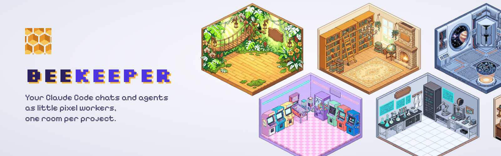
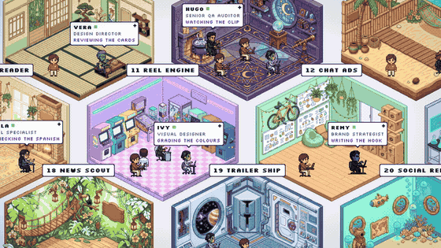
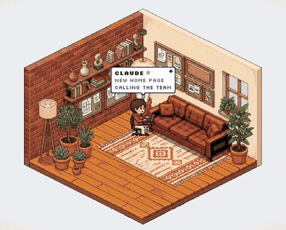
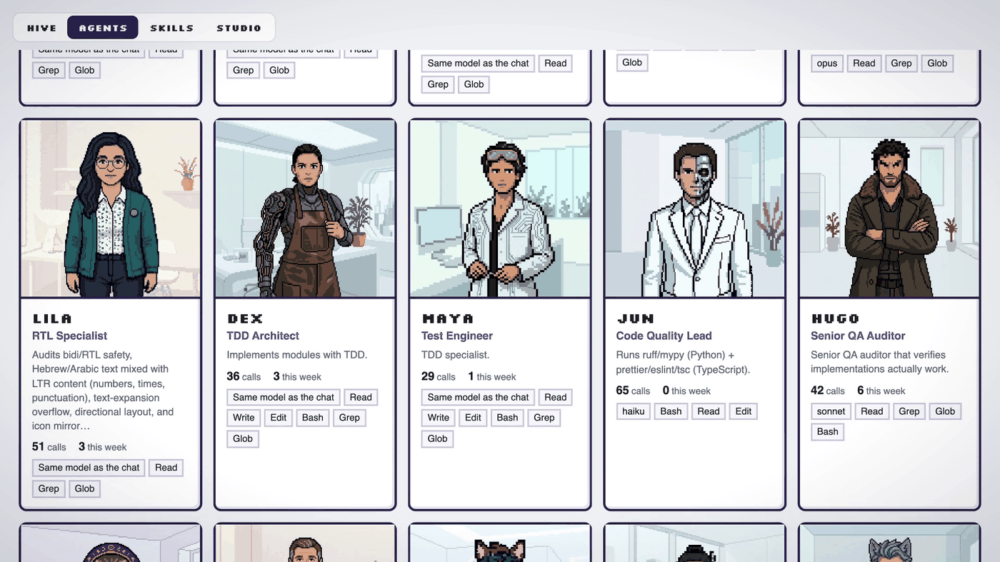

<p align="center">
  
</p>

<p align="center">
  <b>See who is working, who is waiting for you and who fell asleep.</b><br>
  Open BeeKeeper next to your work. Every Claude Code chat walks into the pixel room of its project.
</p>

<p align="center">
  
</p>

## When Claude calls an agent, it steps into the room

<p align="center">
  
</p>

## What you get

- **Hive:** one room per project, one worker per chat, a speech bubble with what it is doing right now.
- **Agents:** every agent found in your Claude folders, with its record: calls, projects, last jobs.

- **Skills:** your skills with how often you used them.
- **Studio:** pick which character plays each agent, pick a room for each project, or draw your own.


<p align="center"></p>

Everything is pixel art.

## Start

You need Node 20 or newer.

```bash
git clone https://github.com/ranucho/beekeeper.git
cd beekeeper
npm install
npm run dev
```

Open http://localhost:8080

Drawing your own rooms also needs Python 3 with two packages:

```bash
pip3 install numpy pillow
```

## Your data stays on your computer

BeeKeeper reads the chat logs and agent files Claude Code already keeps in `~/.claude` and in your project folders. It only reads them. Nothing is uploaded anywhere.

The only thing that leaves your computer is a room drawing: when you press Generate in Studio, your description (and the reference pictures you add) go to Google's image model.

## Rooms and characters

- **Ready rooms and characters are free.** 20 ready rooms and 17 characters come with the app. Pick them in the Studio tab.
- **Drawing your own room costs about 10 cents.** It needs a Gemini key from [Google AI Studio](https://aistudio.google.com/apikey) with billing turned on. Paste it once in Studio. It is checked with Google and saved on your computer in `~/.beekeeper/gemini.key`. It is never part of the project.
- **Your rooms are kept** in the `My rooms` list, so you can use one for any project.
- Rooms are always drawn as pixel art, so they fit the characters.

## Good to know

- A project gets a room when you have used Claude Code in its folder in the last 90 days.
- The app runs two small servers: the page on port 8080 and the data on port 8081.
- Your picks (which character plays which agent, names) are saved in your browser.
